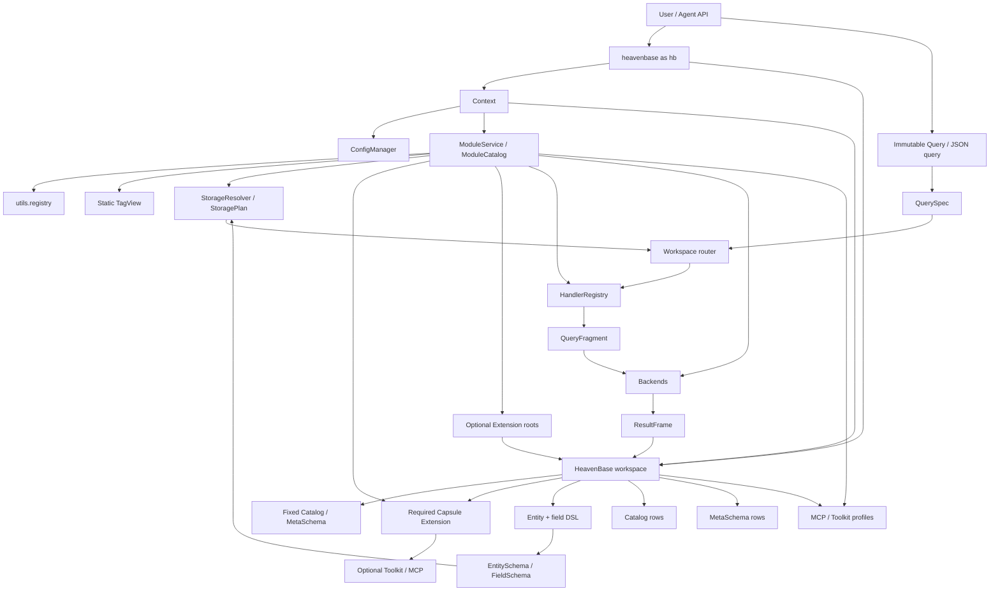

# Architecture Overview

This page gives the high-level control flow. For the canonical boundary contract, read [mental-model.md](mental-model.md). For the design philosophy summary, read [design-philosophy.md](design-philosophy.md).

## System Shape

## Control Flow

1. Users author logical schemas with `Entity` and `field()`.
2. Workspace bootstrap establishes the exact Catalog and MetaSchema classes,
   activates the trusted required Capsule Extension, then resolves stored
   optional Extension roots and their hard dependencies.
3. Schema lifecycle operations establish canonical Entity classes, publish their
   metadata, and resolve field placement into a `StoragePlan`. Explicit
   registration, manifest/extension replay, and active definition-shaped
   Entity-kind MetaSchema writes all delegate to this service.
4. Ordinary row CRUD resolves its target against an already-present canonical
   Entity; it never registers a class or creates placement/schema state as a
   side effect. MetaSchema Entity-definition command ingress is the narrow
   target-specific exception.
5. Writes validate through logical types and fan out to each effective storage binding.
6. Immutable, spec-only `Query` values normalize to `QuerySpec` objects, then
   the workspace router creates temporary route artifacts and groups work by
   selected backend.
7. Handlers compile filter or near clauses into `QueryFragment`s.
8. Backends execute fragments and return identity-bearing `ResultFrame`s.
9. The workspace merges frames by `object_id`, hydrates or projects rows, and
   returns a newly detached `ResultFrame`; repeated execution recomputes.
10. User code explicitly exports that transport container to rows, models,
   scalar values, or an ecosystem-native table.
11. Catalog and MetaSchema rows make objects, schemas, storage placement, exact
   handler support, and extension metadata queryable. Semantic module claims
   stay on Registry records and are inspected through `ModuleService.tag(...)`
   / `.tags(...)`; MetaSchema does not flatten them. Stored metadata remains an
   inspection projection rather than runtime resolution authority.

## Role Summary

| Component | Role |
|-----------|------|
| Root facade | Keeps first-use code short with `import heavenbase as hb`; lazy-loads heavier support surfaces. |
| Context | Owns machine config, Registry namespaces, ModuleResolver, workspace directory/selection, and live workspace identity. |
| Module service / tags | Owns installed-record lifecycle and import-free static tag resolution; a concrete Backend adds construction/live overlays. |
| Workspace | Owns orchestration: schemas, backends, handlers, storage plans, CRUD, query routing, system rows, and MCP exposure. |
| Entity/schema | Owns user-facing meaning and typed structure. |
| Placement | Owns authored rules/profiles and resolved bindings; it performs no physical storage. |
| Execution | Owns neutral fragments, row operations, ResultFrame, shared handler protocol, and portable compilers. |
| Handler registry | Owns Context-local operation compiler and reason lookup. |
| Backend | Owns provider lifecycle, physical IO, and fragment execution. |
| MCP profile | Owns declarative workspace tool, entity, skill, and serializer exposure. |
| ResultFrame | Carries detached table-shaped execution output; `execution.frame` owns internal identity-bearing set composition, while user code exits through explicit exports. |
| Catalog / MetaSchema | Exact, non-replaceable workspace foundation and inspectable metadata contracts. |
| Capsule | Installer-trusted required executable-manifest domain. |
| Extensions | Own optional Entity bundles, workspace APIs, and activation-gated contributions. |
| Toolkit | Owns optional Tool/Toolkit persistence, serializers, profiles, and MCP composition. |

## Why The Pieces Compose

The main variation axes are independent:

- Logical type: what values mean and which tag-declared operation domains may
  nominate candidates.
- Storage strategy: how a field should be placed or indexed.
- Backend: which provider can store or execute a fragment.
- Handler: how one operation compiles for one `(type, op, backend, strategy)` tuple.
- Extension: which entity bundle, tools, or profiles become available in one workspace.

Each open axis is an ordinary record in the Context-owned module catalog,
surfaced through its typed facade. Optional tag definitions and subject
`meta.tags` claims describe open-ended properties without becoming another
planner or proof system. Adding one property or implementation should not
require reopening the workspace router or root facade. When a shortcut is
tempting, check whether the behavior belongs in a module record, Backend
adapter, provider-local handler, placement profile, or extension bundle
instead.

See
[Workspace Foundation and Extensions](workspace-foundation-and-extensions.md)
for installation, activation, dependency, and replay semantics.

## Enforcement

The architecture is protected by two feedback loops:

- Runtime honesty: `query.explain()` reports backend selection, native vs fallback mode, and unsupported reasons.
- Exact-support reporting: `rtk uv run python scripts/gen_capabilities.py` refreshes the source-backed HandlerKey/backend matrix after handler or backend changes; `rtk uv run python scripts/gen_capabilities.py --check` is the standing drift gate.
